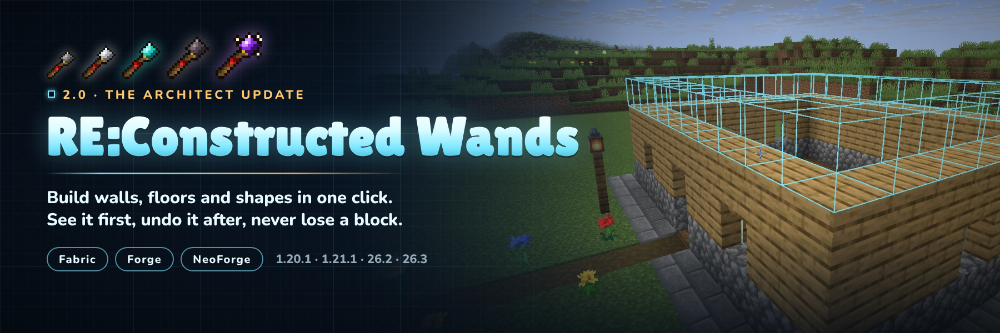

# RE:Constructed Wands



Building wands for Minecraft. Extend a wall, floor or path in one click, place blocks in mid-air, clear or swap whole
surfaces, and build lines, walls, boxes, circles and rings in two clicks. Every click is previewed, every
action can be undone, and blocks come from your shulker boxes, bundles, Ender Chest or a chest you bind the wand to.

**2.0 "The Architect Update"** is a full rebuild: see the [2.0.0 notes](patchnotes/2.0.0.md).

## Which jar do I download?

Jar names are `reconstructedwands-{loader}-{minecraft}-{modVersion}.jar`. Match **both** the Minecraft version and
the loader.

| Minecraft | Java | Fabric jar (needs Fabric API) | NeoForge / Forge jar |
|-----------|------|-------------------------------|----------------------|
| 1.20.1 | 17+ | `…-fabric-1.20.1-….jar` | `…-forge-1.20.1-….jar` (Forge 47) |
| 1.21.1 | 21+ | `…-fabric-1.21.1-….jar` | `…-neoforge-1.21.1-….jar` |
| 26.2 | 25+ | `…-fabric-26.2-….jar` | `…-neoforge-26.2-….jar` |
| 26.3 | 25+ | `…-fabric-26.3-….jar` | `…-neoforge-26.3-….jar` |

The mod is needed on both the server and the client.

## Features

- **Five wands**: Stone, Iron, Diamond, Netherite (smithing upgrade) and the unbreakable Infinity Wand. Wands repair
  in an anvil and take Unbreaking and Mending.
- **Construction**: right-click a face to copy it across every matching block behind it, with a size (Ctrl +
  scroll), a direction lock (Sneak + scroll), exact/similar/any matching and a weighted random palette from the
  hotbar.
- **Cores** (crafted into a wand): **Angel** places in mid-air, **Destruction** clears a surface with the offhand
  tool's drops, **Exchange** swaps a surface for another block, **Architect** builds a line, wall, floor, box or cube
  between two corners, or a circle or ring around a centre.
- **Block supply**: loose stacks, shulker boxes and bundles, a bound chest (Sneak + right-click it), the Ender Chest,
  and last the hotbar.
- **Undo and redo**: Ctrl+Z and Ctrl+Y, ten steps per player, without ever duplicating items.
- **Previews and HUD**: colour-coded outlines (place, remove, missing, undo), a HUD next to the hotbar, a settings
  screen (G or Sneak + right-click the air) and a mode wheel (hold R).
- **Server-safe**: claim and protection checks before anything moves on every loader, deny tags, a synced
  `server.json` and `/wands reload`.

## Installation

1. Install Fabric (with Fabric API) or NeoForge (Forge on 1.20.1) for your Minecraft version.
2. Download the matching jar from [Modrinth](https://modrinth.com/mod/reconstructed-wands/versions) or
   [CurseForge](https://www.curseforge.com/minecraft/mc-mods/re-constructed-wands) using the table above.
3. Put it in your `mods` folder (on the server and on every client).

## Controls

| Input | Action |
|-------|--------|
| Right-click a block | use the current mode |
| Right-click the air | Angel: place in mid-air · Architect: clear the corner |
| G, or Sneak + right-click the air | settings screen |
| Hold R | mode wheel |
| Ctrl + scroll | size |
| Sneak + scroll | direction lock, or the Architect's shape |
| Ctrl + Z / Ctrl + Y | undo / redo (hold Ctrl and Sneak + right-click also undoes) |
| Sneak + right-click a container | bind or unbind it as a block source |

## Configuration

On first launch the mod writes two commented files to `config/reconstructedwands/`. Missing keys are restored with
their defaults, and `/wands reload` (permission level 2) applies changes without a restart.

| File | What it controls |
|------|------------------|
| `server.json` | Per-tier durability and limits, which cores work, the creative limit, the maximum range, undo depth, block sources, Destruction drops, falling Angel use, similar-block groups. Sent to every player so previews match the server. |
| `client.json` | Previews and their colours, the HUD, the undo shortcuts, the scroll gestures, Sneak + right-click opening the screen |

Block tags (datapacks can add to them):

- `#reconstructedwands:denied`: never placed, removed or swapped by a wand (bedrock, spawners, portals, command blocks…).
- `#reconstructedwands:no_dismantle`: never removed by Destruction or Exchange (ores, budding amethyst, suspicious
  sand and gravel, infested blocks).

## Upgrading from 1.x

Item IDs are unchanged, and a wand's cores and settings are stored under the same keys, so existing wands keep them.
The recipes changed: wands now have a redstone binding in the middle (no clash with any vanilla recipe).

## Building

Each Minecraft version is a separate MultiLoader Gradle workspace (`common/`, `fabric/` and `neoforge/`, or `forge/`
on 1.20.1). Gradle needs the workspace's Java version: 17 for 1.20.1, 21 for 1.21.1, 25 for 26.x.

```bash
cd 26.3
./gradlew build          # jars in fabric/build/libs and neoforge/build/libs
./gradlew :common:test   # shape and config-file unit tests
```

Prebuilt release jars go in `releases/` for the publish workflow. Release notes for a version live in
`patchnotes/<version>.md`.

## Tools

- [`tools/assets/`](tools/assets): draws every wand and core texture (`python3 tools/assets/textures.py`).
- [`tools/qa/`](tools/qa): runs dev servers and a real game client under Xvfb. `wand_checks.py` uses every mode in
  survival and checks undo, redo, size, lock, every block source, drops, the deny tag and the reload command.
  `marketing_shots.py` builds and captures the listing screenshots.
- [`marketing/`](marketing): the CurseForge/Modrinth description, listing images and how to regenerate them.
- [`docs/DESIGN-2.0.md`](docs/DESIGN-2.0.md): the design notes behind 2.0.

## Links

- [Discord](https://discord.gg/SAmd9fhNhr)
- [Modrinth](https://modrinth.com/mod/reconstructed-wands/versions)
- [CurseForge](https://www.curseforge.com/minecraft/mc-mods/re-constructed-wands)
- [Ko-fi](https://ko-fi.com/nightbeamstudio)

## Contributing

See [CONTRIBUTING.md](CONTRIBUTING.md). Please follow the [Code of Conduct](CODE_OF_CONDUCT.md).

## Security

See [.github/SECURITY.md](.github/SECURITY.md).

## License

Licensed under the [Apache License, Version 2.0](LICENSE). Based on Construction Wand by ThetaDev (MIT); see
[NOTICE](NOTICE) for the full attribution and the bundled Common Protection API.
