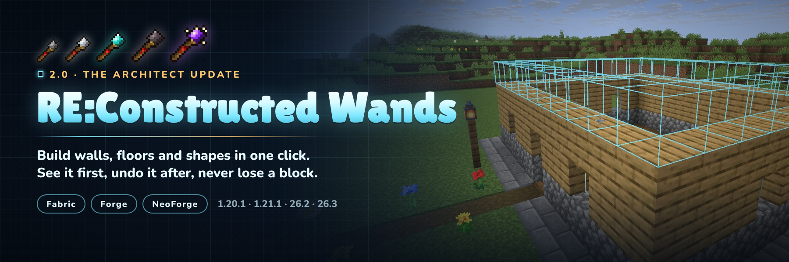

**[Docs](https://nightbeam.dev/docs/reconstructed-wands) · [Discord](https://discord.gg/TJc3CxR4jK) · [Source and issues](https://github.com/MeherBenSalem/modern-building-wands)**

**Build the boring parts in one click.** Point a wand at a wall and the next layer appears. Fill a floor, clear a
cliff face, swap cobblestone for stone bricks, or click twice and get a ring, a box or a whole wall. You see
every block before you click, you can undo anything, and the wand takes its blocks from your shulker boxes, bundles,
Ender Chest or a chest you bind it to.

Fabric and NeoForge (Forge on 1.20.1) · Minecraft 1.20.1, 1.21.1, 26.2 and 26.3 · install on server and client

Version 2.0 rebuilds the whole mod. Here's what changed from 1.x:

- Two new cores: **Exchange** swaps a surface for another block, **Architect** builds lines, walls, floors, boxes and
  cubes between two corners, and circles and rings around a centre
- **Undo and redo** with Ctrl+Z and Ctrl+Y, ten steps deep, and nothing is ever duplicated
- Blocks come from **shulker boxes, bundles, your Ender Chest and a bound chest**
- **Ctrl + scroll** sets how many blocks a click places, **Sneak + scroll** locks a direction
- A **HUD**, a **mode wheel**, a new settings screen and colour-coded previews
- **Claims and protection are respected on every loader**, checked before anything moves
- A server config synced to every player, deny tags, and `/wands reload`
- New textures, recipes that no longer clash with vanilla, repairable and enchantable wands
- Your 1.x wands keep their cores and settings

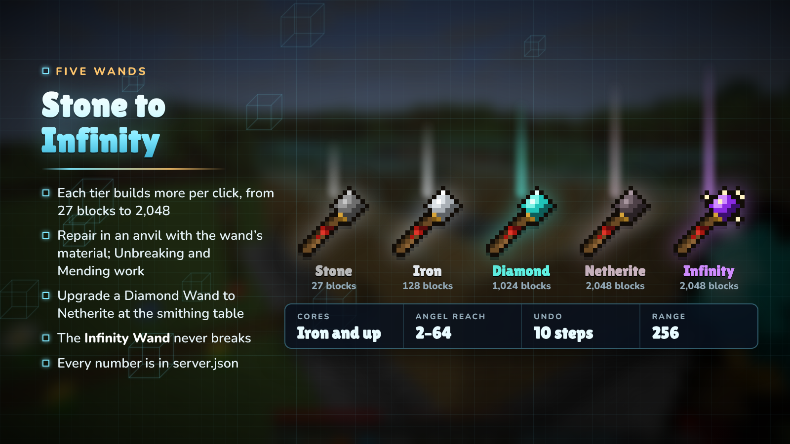

| Wand | Durability | Blocks per click | Angel reach | Destruction / Exchange | Cores |
|------|-----------|------------------|-------------|------------------------|-------|
| Stone | 131 | 27 | 2 | 4 | no |
| Iron | 250 | 128 | 4 | 9 | yes |
| Diamond | 1,561 | 1,024 | 16 | 81 | yes |
| Netherite | 2,031 | 2,048 | 32 | 128 | yes |
| Infinity | unbreakable | 2,048 (8,192 in creative) | 64 | 128 | yes |

Wands repair in an anvil with their material and take Unbreaking and Mending. The Netherite Wand is a smithing
upgrade of the Diamond Wand. Server owners can change every number in `server.json`.

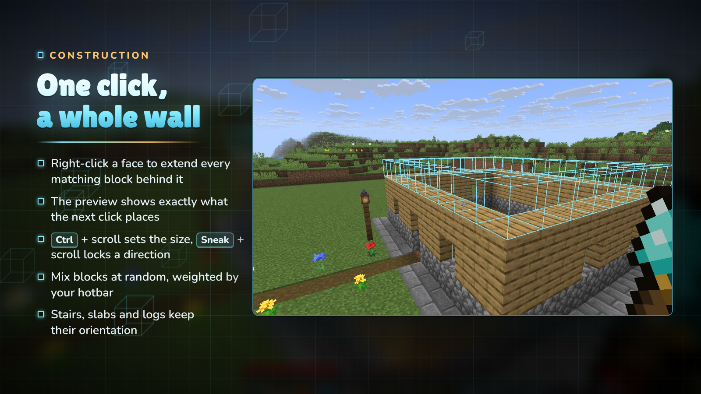

Right-click the face of a block and the wand copies that face across every matching block behind it: the top of a
floor adds a layer, the side of a wall makes it thicker, the edge of a path makes it wider. The outline shows exactly
what the next click will place, and turns red where you are short of blocks.

- **Ctrl + scroll** sets the size, from one block up to the wand's limit.
- **Sneak + scroll** locks the direction: horizontal, vertical, north/south or east/west.
- **Match** decides what counts as the same block: exact, similar (dirt and grass together) or anything.
- **Random** mixes the blocks in your hotbar, weighted by how many slots hold each one.
- Stairs, slabs, logs and pillars keep their orientation.

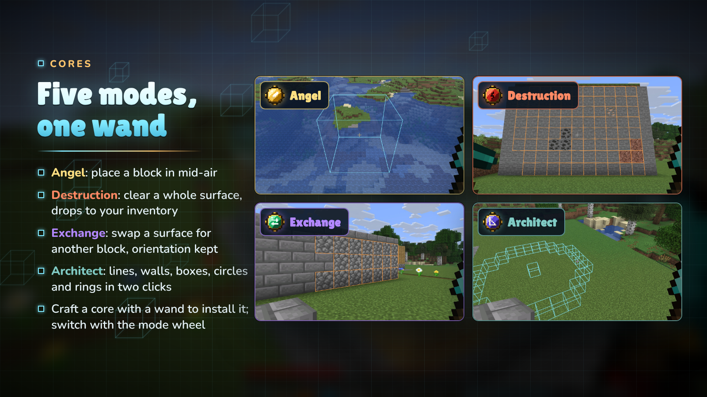

Craft a core together with an Iron, Diamond, Netherite or Infinity Wand to install it. A wand holds every core at
once; switch modes with the mode wheel (hold **R**) or the settings screen.

- **Angel Core**: place a block in mid-air in front of you, or behind the block you click. Bridges, sky bases and
  scaffolding without scaffolding.
- **Destruction Core**: remove the exposed surface of matching blocks. The drops go straight to your inventory, as if
  you broke them with the tool in your offhand, so a Silk Touch pickaxe there gives you the blocks themselves.
- **Exchange Core** (new): swap a surface for the block in your offhand. Stairs and logs keep their facing, and the
  old blocks come back to you.
- **Architect Core** (new): build shapes with two clicks. See below.

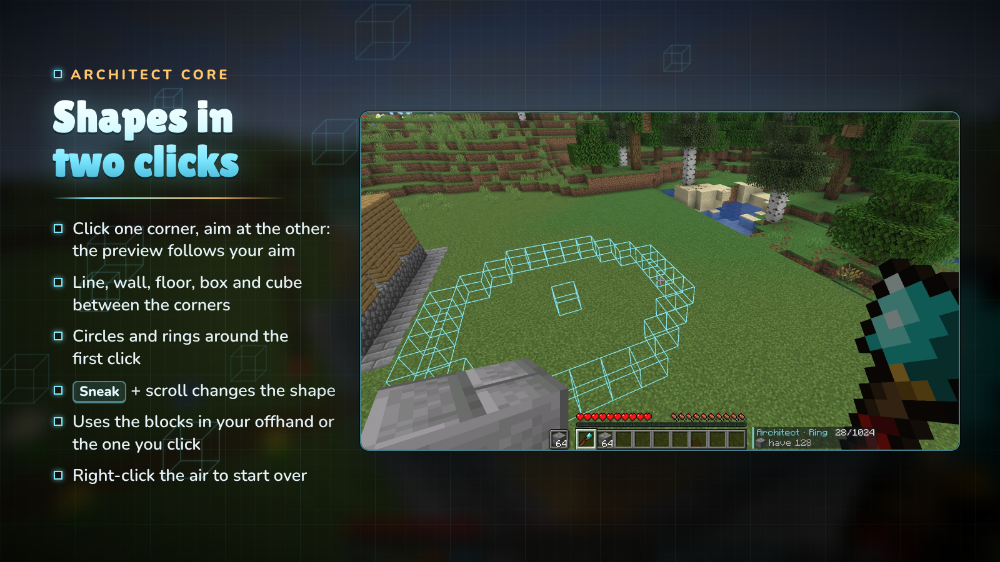

Right-click one corner, then aim at the other: the preview follows your aim and the next right-click builds
it. A **line, wall, floor, box or cube** fills the space between the two corners; a **circle or ring** is centred on
the click you started with and reaches out to the second. Pick the shape with Sneak + scroll, and right-click the air to clear the
starting click and start again.

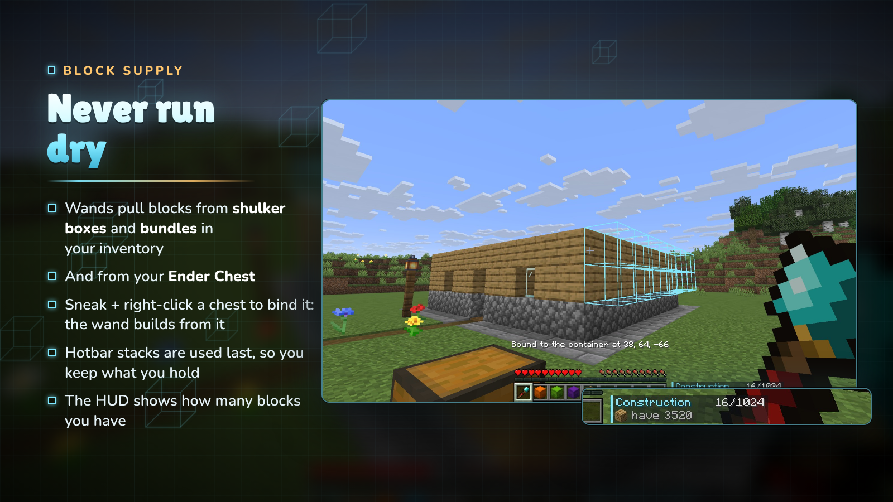

Wands look for blocks in this order:

1. loose stacks in your inventory,
2. **shulker boxes and bundles** you carry,
3. the **chest you bound** the wand to (Sneak + right-click a chest, barrel or shulker box; again to unbind),
4. your **Ender Chest**,
5. and last your hotbar and offhand, so the stacks you hold are kept longest.

The HUD shows how many blocks you have across all of them. Just plain blocks are used: a renamed or enchanted stack is
never placed by mistake.

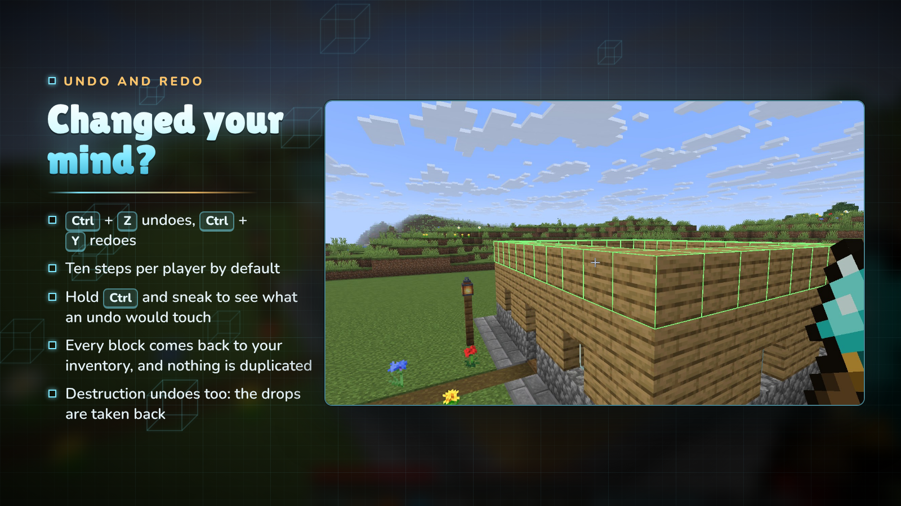

**Ctrl + Z** undoes your last wand action and **Ctrl + Y** redoes it, ten steps back by default. Hold Ctrl and sneak
to see what an undo would touch. Undo gives back exactly the blocks it removes and takes back exactly the drops a
Destruction gave you, so it can never be used to duplicate items. The 1.x gesture (hold Ctrl, sneak and right-click)
still works.

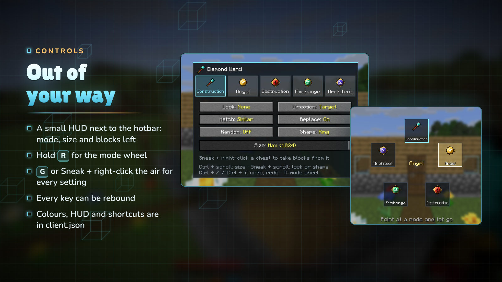

| Input | What it does |
|-------|--------------|
| Right-click a block | use the current mode |
| Right-click the air | Angel: place in mid-air · Architect: clear the corner |
| G, or Sneak + right-click the air | settings screen |
| Hold R | mode wheel: point at a mode and let go |
| Ctrl + scroll | size |
| Sneak + scroll | direction lock, or the Architect's shape |
| Ctrl + Z / Ctrl + Y | undo / redo |
| Sneak + right-click a container | bind or unbind it as a block source |

Every key can be rebound in the controls menu, and `client.json` turns off the HUD, the previews, the scroll gestures or
the shortcuts and changes the preview colours.

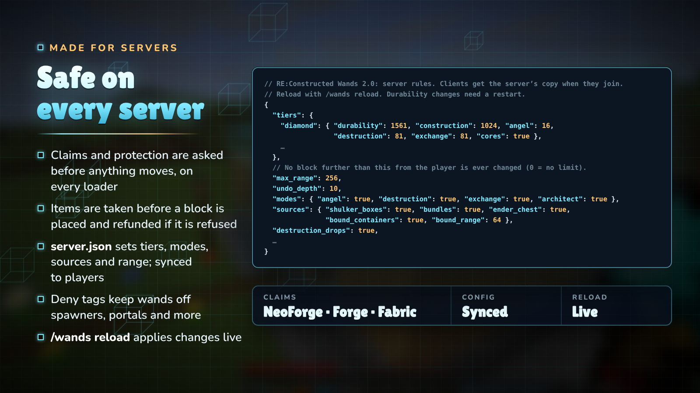

- **Claims and protection**: every block is checked before any item moves. NeoForge and Forge fire their normal place
  and break events (so claim mods can cancel them), and on Fabric the wand asks the claim mods that implement the
  Common Protection API (bundled) and fires Fabric's break events.
- **No duplication**: the item is taken before the block is placed and refunded if the placement is refused, shulker
  boxes are edited through their item data, doors and beds are never placed half, and undo never prints items.
- **`config/reconstructedwands/server.json`**: tier limits and durability, which cores work, the creative limit, the
  maximum range, undo depth, block sources, whether Destruction gives drops, and groups of similar blocks. It is sent to
  every player, so previews always match what the server will do. `/wands reload` applies changes live.
- **Deny tags**: blocks in `#reconstructedwands:denied` are never placed, removed or swapped by a wand (bedrock,
  spawners, portals, command blocks and more by default); `#reconstructedwands:no_dismantle` protects ores and
  suspicious sand from Destruction and Exchange.

- **Wands**: the material in the top-right corner, redstone in the middle and a stick in the bottom-left (cobblestone,
  iron, diamond, or a nether star for the Infinity Wand). Netherite: upgrade a Diamond Wand at a smithing table.
- **Cores**: glass panes around the centre, with
  - Angel: a feather and two gold ingots
  - Destruction: a block of diamond and two diamond pickaxes
  - Exchange: an ender pearl and two emeralds
  - Architect: a compass and two amethyst shards
- **Install a core**: put the wand and the core anywhere in a crafting grid.

| Minecraft | Fabric | NeoForge / Forge | Java |
|-----------|--------|------------------|------|
| 26.3 | ✔ (Fabric API) | ✔ NeoForge | 25 |
| 26.2 | ✔ (Fabric API) | ✔ NeoForge | 25 |
| 1.21.1 | ✔ (Fabric API) | ✔ NeoForge | 21 |
| 1.20.1 | ✔ (Fabric API) | ✔ Forge | 17 |

Pick the file whose name has your Minecraft version and loader, for example
`reconstructedwands-fabric-1.21.1-2.0.0.jar`.

**Do my 1.x wands still work?** Yes. Item IDs are unchanged and wands keep their cores and settings.

**Is it needed on the server and the client?** Both. It adds items, and the client draws the previews and the HUD.

**Will it let players grief claimed land?** No. Every block is checked with the loader's protection hooks before
anything changes, the same way a block placed by hand is.

**Can I stop wands from touching certain blocks?** Yes: add them to `#reconstructedwands:denied` with a datapack.

**Can I make wands weaker or stronger?** Yes. Every tier's limits and durability are in `server.json`, and any core
can be turned off.

**Does Destruction work with Fortune and Silk Touch?** Yes. Drops are worked out with the tool in your offhand.

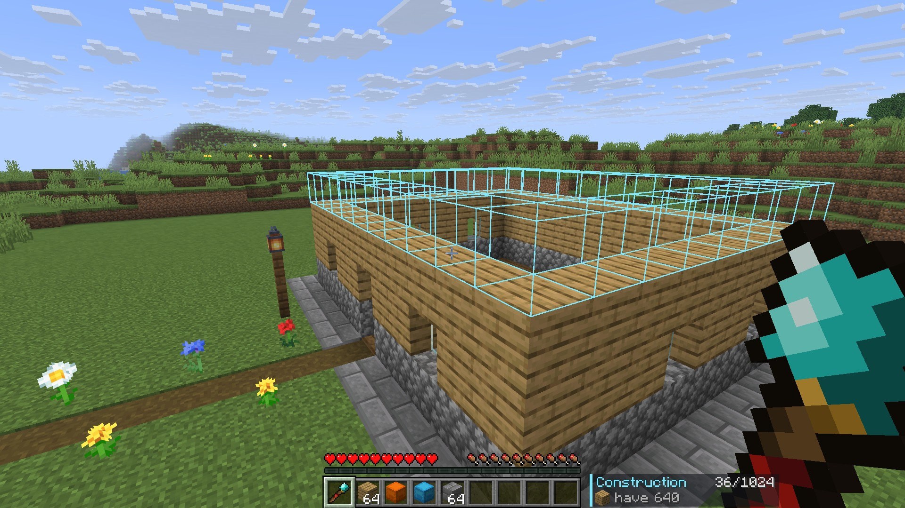

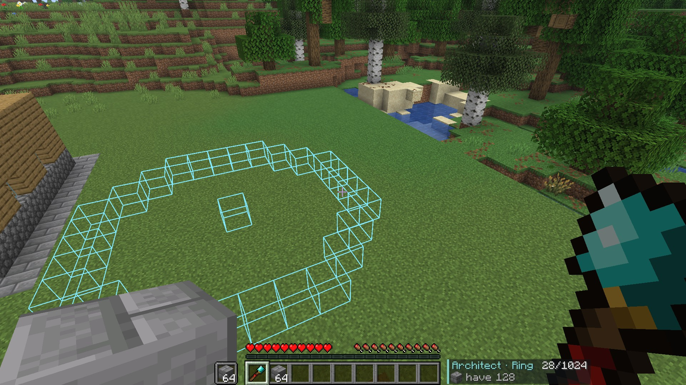

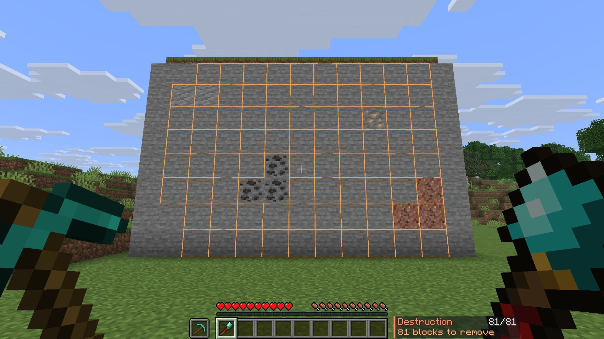

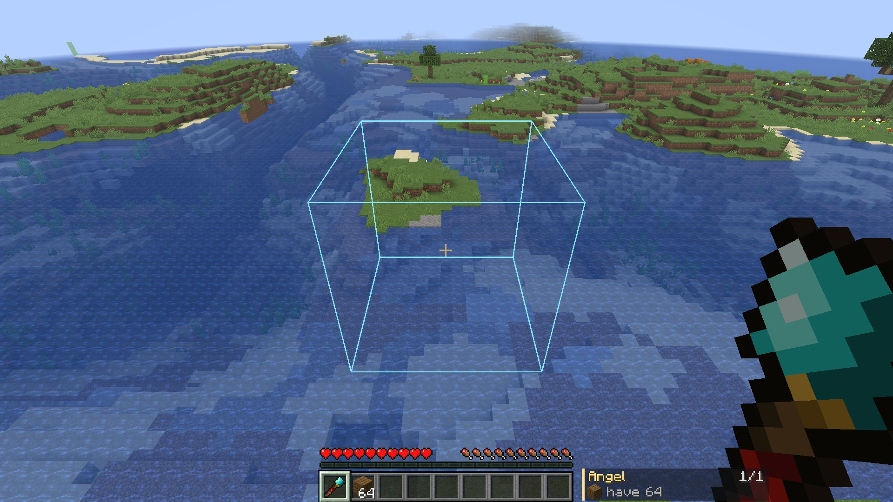

---

> **Featured in [Remnants: Ashen Legacy](https://www.curseforge.com/minecraft/modpacks/remnants-ashen-legacy)**, NightBeam's story-driven soulslike RPG modpack.

---

### More from NightBeam Studio

- **[Remnants: Ashen Legacy](https://www.curseforge.com/minecraft/modpacks/remnants-ashen-legacy)**: the story-driven soulslike RPG modpack built on NightBeam's mods
- **[Premium server plugins](https://nightbeam.dev/store)**: anti-cheat, ranked PvP, SMP setups and more on BuiltByBit
- **[NightBeam Pro](https://nightbeam.dev/memberships)**: the model library and NightBeam Forge credits, from $5 a month
- **[Discord](https://discord.gg/TJc3CxR4jK)**: support, bug reports, suggestions and early looks
- **[Support NightBeam](https://nightbeam.dev/support)**: help keep every mod free

**Follow:** [YouTube](https://www.youtube.com/@nightbeamstudio) · [Instagram](https://www.instagram.com/nightbeamstudio/) · [X](https://x.com/NightBeamLLC) · [Facebook](https://www.facebook.com/profile.php?id=61574823331471)
